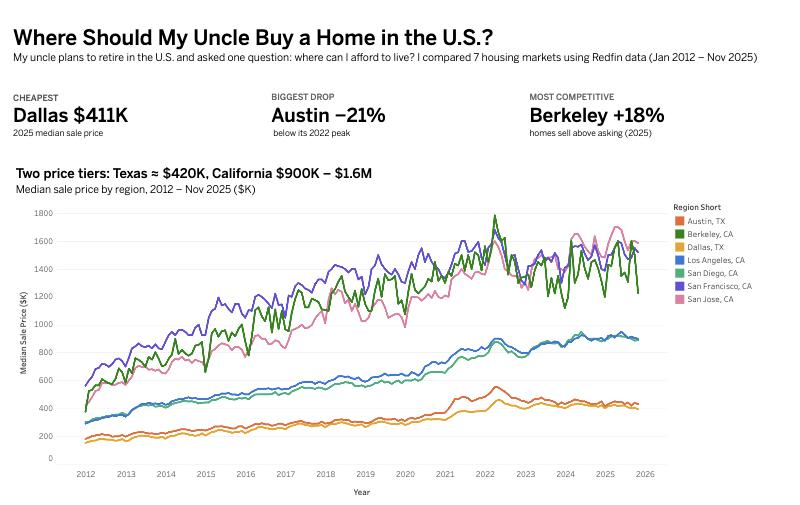
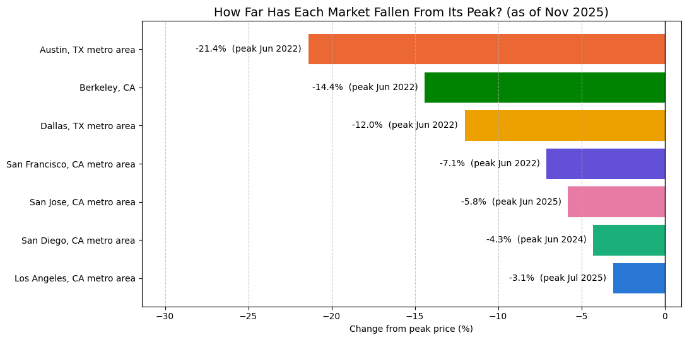
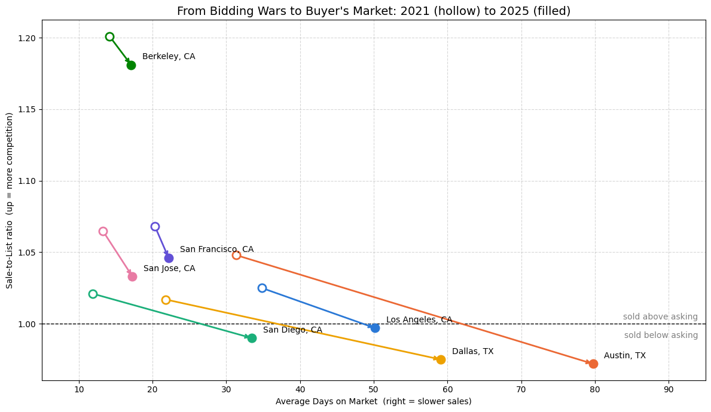
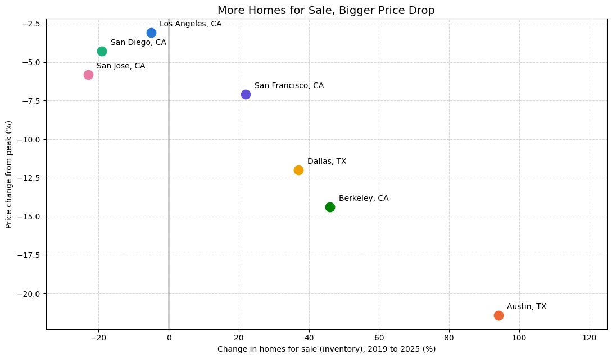

# Where Should My Uncle Buy a Home in the U.S.?

My uncle plans to retire in the U.S. and asked one question: where can he afford to live? I compared 7 housing markets in Texas and California using Redfin data (Jan 2012 – Nov 2025, 1,169 market-months).

**Short answer:** Dallas offers the best value today: it is the cheapest market, buyers have bargaining power, and prices have fallen less than in Austin. If he prefers California, Los Angeles or San Diego cost about twice as much but have held their value. The Bay Area only makes sense if living there matters more than the cost.

**[View the interactive Tableau dashboard →](https://public.tableau.com/app/profile/jeremy.liao/viz/WhereShouldMyUncleBuyaHomeintheU_S/WhereShouldMyUncleBuy)** (includes a budget slider to see which markets fit)



## The story in four questions

**1. How expensive is each market?** There are two price tiers. Texas sells around $420K (Dallas $411K, Austin $435K). California runs from about $910K (Los Angeles, San Diego) to $1.4M–$1.6M (Bay Area). Prices grew 2.2x to 3.0x from 2012 to 2025.

**2. Which markets fell after the 2022 rate hikes?** Cheap is not the same as safe. Austin had the biggest boom (+31% in 2021 alone) and the biggest bust (−21% from its peak). In 2025, only the two Texas markets were still falling.



**3. Buyer's market or seller's market?** Every market cooled after 2021, when all 7 sold above asking price. By 2025, Austin, Dallas and San Diego sold below asking. Austin went from 31 to 80 days on market. The Bay Area barely changed.



**4. Does supply explain the price drops?** The more homes piled up, the more prices fell. Inventory change since 2019 and drop from peak have a correlation of −0.95, and still −0.88 with Austin removed. With only 7 markets, this is a pattern, not proof.



| Market | 2025 price | From peak | Sale-to-list | Days on market | Inventory vs 2019 |
|---|---|---|---|---|---|
| Dallas, TX | $411K | −12.0% | 0.975 | 59 | +37% |
| Austin, TX | $435K | −21.4% | 0.972 | 80 | +94% |
| San Diego, CA | $905K | −4.3% | 0.990 | 33 | −19% |
| Los Angeles, CA | $916K | −3.1% | 0.997 | 50 | −5% |
| Berkeley, CA | $1,415K | −14.4% | 1.181 | 17 | +46% |
| San Francisco, CA | $1,514K | −7.1% | 1.046 | 22 | +22% |
| San Jose, CA | $1,610K | −5.8% | 1.033 | 17 | −23% |

"From peak" uses a 3-month rolling average, so a single unusual month does not set the peak.

## Decisions along the way
- **Outliers kept.** The extreme months all fell in the 2021–22 bidding wars and Austin's 2025 slowdown. They are real market events, so removing them would have removed the story.
- **3-month average for the peak.** On single months, Berkeley looked like it fell 31%, because its peak was a one-month spike. The 3-month average gives 14%.
- **One Dallas series.** The data had both Dallas city and the Dallas metro area. Only the metro area was kept, so every market is measured the same way.

## What did not work
- **"Pricier homes sell faster"** looked true across all markets (correlation −0.49) but disappeared within each market (−0.41 to +0.40). The Bay Area is both expensive and fast, and Texas is both cheap and slow. The region drove the pattern, not the price (confounding).
- **Raw counts** like homes sold cannot be compared across markets (Berkeley sells about 57 homes a month, Los Angeles about 5,657).
- **Month-over-month change** was too noisy: in 2021 prices rose 16%, yet 35% of months showed a decline.

## Limitations
- Median sale prices mix home types and sizes.
- 2025 data runs only through November.
- Berkeley is a city; the other markets are metro areas.
- Property tax, insurance, interest rates and cost of living are not included.
- Correlation is not causation.

## Files
- `Housing_Analysis.ipynb`: full analysis with outputs (cleaning, distributions, the four questions, dead ends, recommendation)
- `data/Redfin_data.csv`: raw data
- `data/housing_monthly_clean.csv`: cleaned monthly data, one row per market per month (used in Tableau)
- `data/housing_region_summary.csv`: one row per market (used in Tableau)
- `requirements.txt`: Python packages

The notebook was written in Google Colab. To run it locally, skip the Google Drive cell and point `pd.read_csv` to `data/Redfin_data.csv`.

```
pip install -r requirements.txt
jupyter notebook Housing_Analysis.ipynb
```

## Data source
[Redfin Data Center](https://www.redfin.com/news/data-center/)
